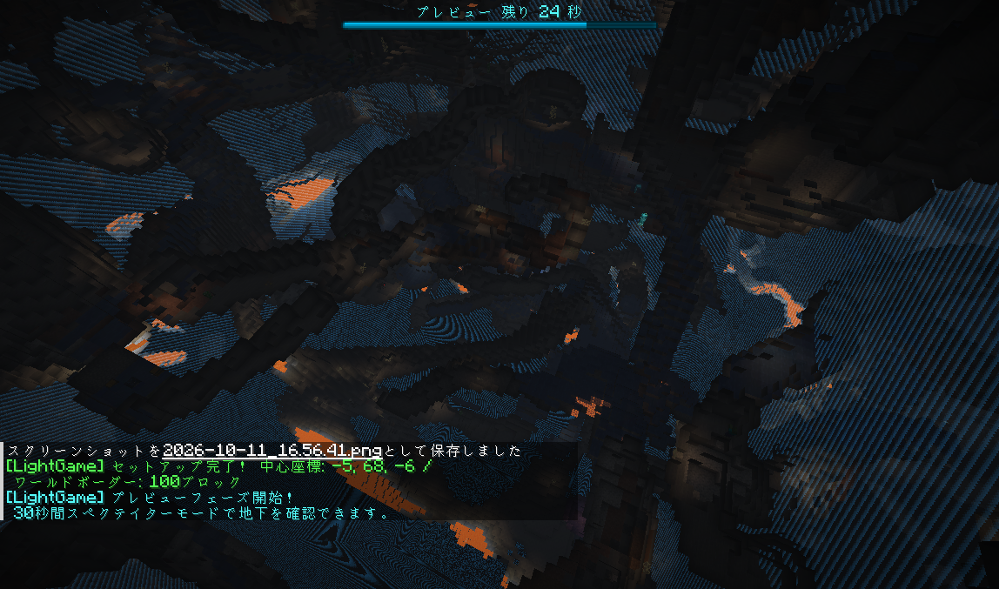
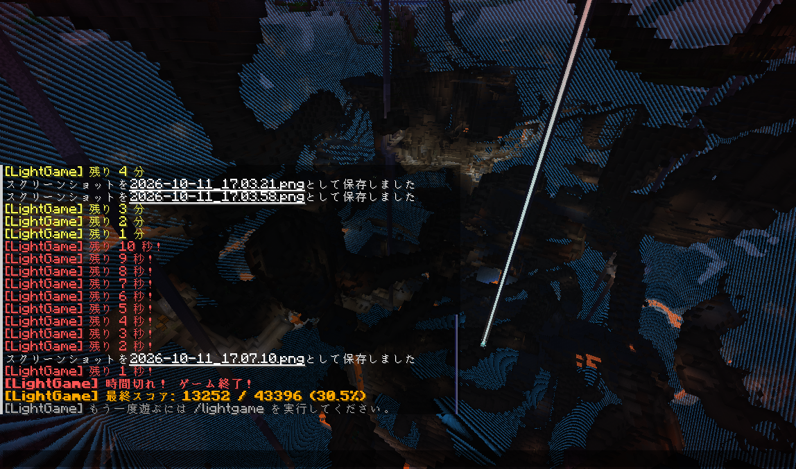
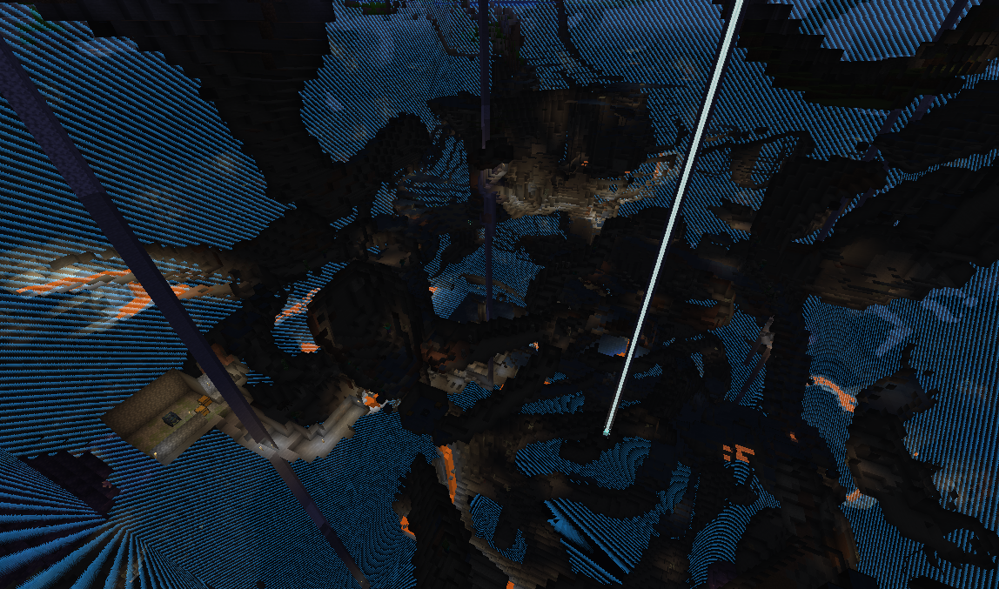
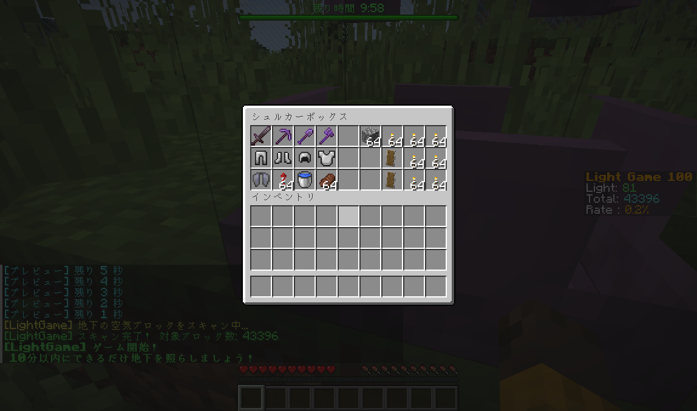
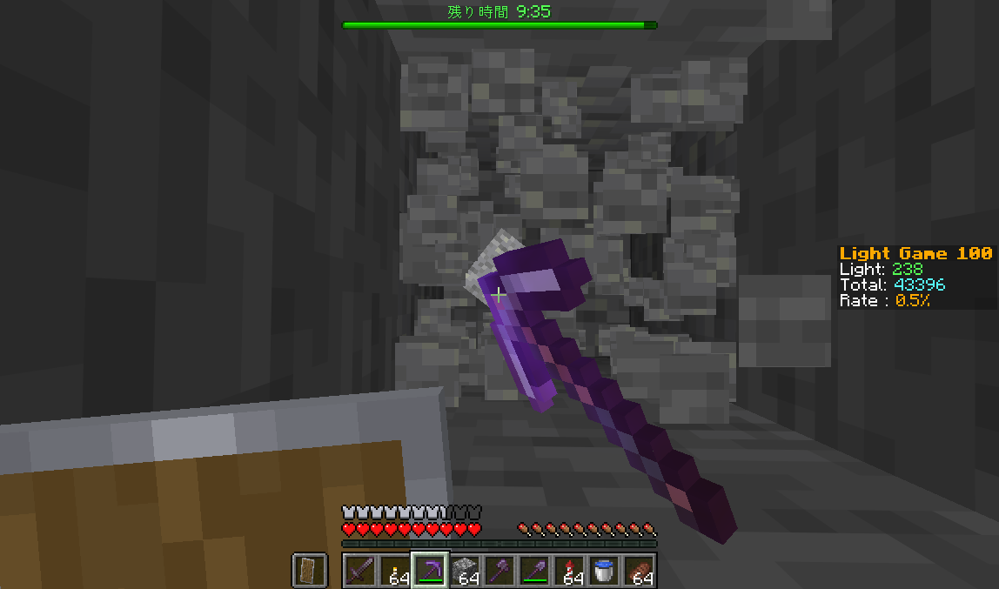
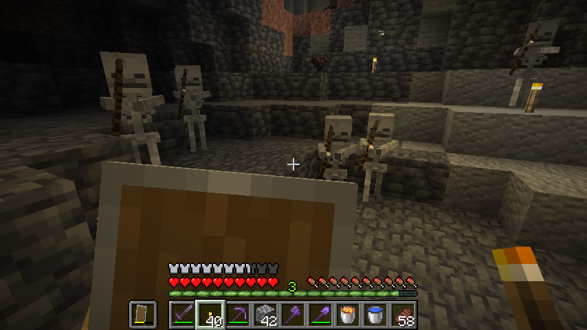
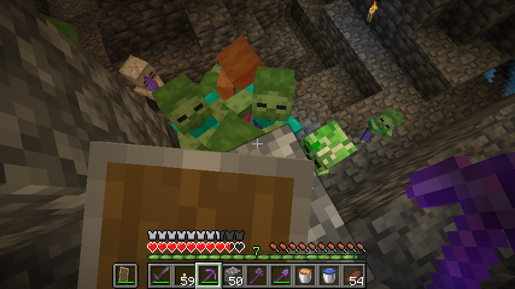
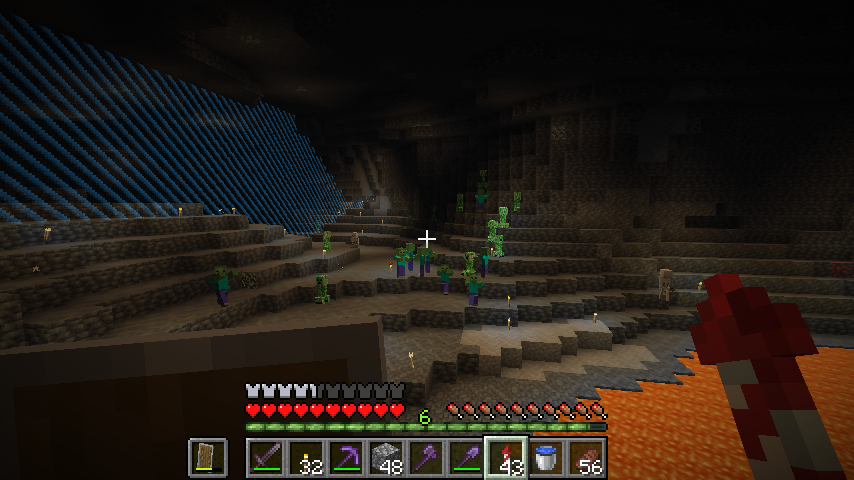

# Light Game 100（松明マイクラ）
100 マスワールドを 10 分で照らすミニゲームです。プレイヤースキルが要求されます。

## 遊び方
- 1: MOD を入れてください
    - こちらから: <https://github.com/stakiran/lightgame100>
- 2: クリエイティブ・ハードでワールドを新規します
- 3: `/lightgame` コマンドを実行します

プレビューモード 30 秒の後、10 分で出来るだけ照らしてください。

## ギャラリー
プレビュー:

ゲーム終了後:

支給アイテムはこんな感じ:

直下掘りは必須です。もちろん水バケツ着地も必須です:

100 マスワールドと狭いので MOD が密集します。以下くらいは **割とよくあります** :

  
